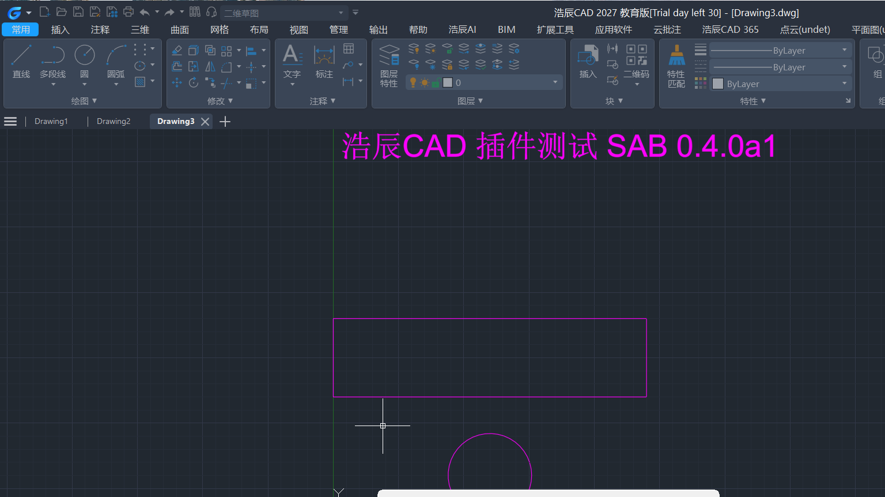

# ESAB — Engineering Software Agent Bridge

**Let AI agents drive the engineering software you already own.**

ESAB is a [Model Context Protocol](https://modelcontextprotocol.io) bridge. It connects an MCP client
(Cursor, Claude Desktop, or your own agent) to engineering software that is *already installed and
licensed on your machine* — CAD, CAE, structural analysis, BIM, and office tooling — and exposes each
product's real API as callable tools.

ESAB does not model, does not compute, and does not bypass licensing. It is a transport and
verification layer between an agent's reasoning and a commercial program's automation interface.

```
        ┌───────────────────────────────┐
        │  MCP client (agent)           │
        └───────────────┬───────────────┘
                        │ MCP / stdio or token-guarded HTTP
        ┌───────────────▼───────────────┐
        │  ESAB                         │
        │  ├─ python_executor (persistent session)
        │  ├─ use_skill   (per-product API skills)
        │  └─ adapters    (15 connection entries)
        └───┬───────────┬───────────┬───┘
            │ COM       │ SDK       │ MCP / REST
     ┌──────▼─────┐ ┌───▼──────┐ ┌──▼──────────────────────┐
     │ SAP2000    │ │ Abaqus   │ │ PKPM · PKPM-CAE · SAUSG  │
     │ ETABS      │ │ Tekla    │ │ PlantS · BIMBase · GBP   │
     │ STAAD      │ │ SketchUp │ │ MIDAS GEN NX             │
     │ AutoCAD    │ │ Rhino    │ │                          │
     │ GstarCAD   │ │          │ │                          │
     │ ZWCAD      │ │          │ │                          │
     └────────────┘ └──────────┘ └──────────────────────────┘
```

## Why this exists

Every engineering program has an automation interface, and every one of them is different: COM
dispatch here, a .NET SDK there, a local MCP server on a random port, a REST endpoint with a custom
header. An agent cannot discover any of that on its own, and guessing is worse than failing — a
fabricated `AddBeam()` call that silently "succeeds" is how engineers learn to distrust AI tooling.

ESAB's design constraint is therefore **the bridge must never report success it cannot prove**:

- every connection entry returns a `ConnectResult` carrying `ok`, `live_verified`, the evidence used,
  and a diagnostic message;
- a successful connect requires a real round trip with the target program — COM `app.Version` read
  back, MCP `initialize` + `list_tools` handshake, TCP health probe with response-id validation;
- when the target is closed, the result is a specific diagnosis (`REGDB_E_CLASSNOTREG`,
  `ConnectionRefusedError: 10061`, "no running `pkpmmcp` process"), never an empty tool list and never
  a hallucinated capability;
- tool schemas come from the upstream server verbatim. ESAB does not invent tools for software that
  is not running.

This is not a stylistic preference. During the 0.4.0 audit, three separate false-success paths were
found and fixed — see [docs/cad-integration-report.md](docs/cad-integration-report.md).

## Supported software

| Product | Category | Interface | Adapter |
|---|---|---|---|
| SAP2000 | Structural analysis | COM (`SAP2000v1.Helper`) | `connect_sap2000` |
| ETABS | Structural analysis | COM (`ETABSv1.Helper`) | `connect_etabs` |
| STAAD.Pro | Structural analysis | `openstaadpy` | `connect_staad` |
| MIDAS GEN NX | Structural analysis | REST + `MAPI-Key` | `connect_midas` |
| Abaqus | FEA | Official Python module over TCP | `connect_abaqus` |
| Tekla Structures | Detailing / BIM | .NET (`pythonnet`) | `connect_tekla` |
| Rhino | Modelling | COM, attach-first | `connect_rhino` |
| AutoCAD / GstarCAD / ZWCAD / BricsCAD | Drafting | COM with product resolution | `connect_cad` |
| SketchUp | Modelling | Ruby bridge over TCP | `connect_sketchup` |
| PKPM (main / STS / JCCAD) | Chinese structural suite | Local MCP server | `connect_structural_pm` |
| PKPM-CAE | FEA | Local MCP server | `connect_structural_cae` |
| SAUSG | Nonlinear analysis | Local MCP server | `connect_sausg` |
| PlantS | Plant structure design | Local MCP server | `connect_plants` |
| BIMBase | Parametric BIM | Local MCP server | `connect_bimbase` |
| GBP | Green building / carbon | Local MCP server | `connect_gbp` |

`connect_cad` resolves the actual CAD product at runtime: `AutoCAD.Application` is probed first, then
redirected to `GstarCAD.Application` / `GCAD.Application` / `ZWCAD.Application` / `BricsCAD.Application`
when the generic ProgID is absent. This matters in practice — a GstarCAD install has no
`AutoCAD.Application` at all, so a hard-coded ProgID fails with `REGDB_E_CLASSNOTREG` on a machine
where the software is running perfectly well.

## Install

```bash
pip install esab
```

Windows adapters need extra dependencies:

```bash
pip install "esab[win32]"          # comtypes, pywin32, pyautocad — COM products
pip install "esab[win32,tekla]"    # adds pythonnet for Tekla
```

Python 3.11+. The bridge itself is cross-platform; COM-based adapters are Windows-only by nature.

## Quick start

ESAB runs in two modes.

### 1. Bridge mode — aggregate upstream MCP servers

Use this when the software ships its own MCP server (PKPM, CAE, SAUSG, PlantS, BIMBase, GBP) or when
you have a fixture you want to test transport against.

```bash
esab stdio --config bridge.json
```

```jsonc
// bridge.json
{
  "servers": [
    {
      "id": "pkpmmcp",
      "enabled": true,
      "transport": "streamable_http",
      "url": "http://127.0.0.1:PORT/mcp",   // from the diagnostic script, never guess
      "notes": "PKPM main module"
    }
  ]
}
```

Register it in your client (`examples/cursor.mcp.json`, `examples/claude_desktop.mcp.json`):

```json
{
  "mcpServers": {
    "esab": {
      "command": "esab",
      "args": ["stdio", "--config", "/path/to/bridge.json"]
    }
  }
}
```

### 2. Runtime mode — skills + a persistent Python session

Use this for COM/SDK products. The agent gets a long-lived Python process with `connect_to_server`,
`connect_cad`, `function_search` and `use_skill` already injected, so it can connect, inspect the real
object model, and iterate without reconnecting on every call.

```bash
esab agent --skills-root ./skills
```

Tools exposed in this mode:

| Tool | Purpose |
|---|---|
| `python_executor` | Run code in a session-persistent Python process. Variables survive across calls. |
| `use_skill` | Read a product's `SKILL.md` verbatim, or run a script shipped with the skill. |
| `cancel_execution` | Kill the session's Python process. Does **not** cancel work already submitted to the target program. |
| `list_software_adapters` | All 15 connection entries, with evidence and live-verification status. |

### HTTP mode

Streamable HTTP is available but never binds to a non-loopback address without both an explicit flag
and a bearer token:

```bash
export ESAB_TOKEN=$(openssl rand -hex 32)
esab http --host 127.0.0.1 --port 47331 --token "$ESAB_TOKEN"
# remote binding also requires: --allow-remote
```

## Skills

Each supported product ships a skill: `SKILL.md` plus reference material and helper scripts — plain
Markdown and Python, no encryption. Skills are what turn "there is an API" into "the agent knows the
API": object model, worked examples, and the error codes you will actually hit.

The bigger products ship a searchable API index (`data/skills/*/references/*.db`) built from the
vendor's own API documentation: Tekla, Abaqus (2024/2025/2026), MIDAS, SAP2000, ETABS, Rhino,
SketchUp. That is what lets an agent look up `SAPModel.FrameObj.AddByCoord` and its overloads instead
of guessing at signatures. These indexes account for ~95 MB of the repository; they are committed
rather than fetched so a clone is immediately usable.

Included skills: SAP2000, ETABS, STAAD.Pro, MIDAS, Abaqus, Tekla, Rhino, SketchUp, AutoCAD,
PKPM, PKPM-CAE, SAUSG (SSG), PlantS, BIMBase, GBP, plus Word, Excel, PPT and PDF authoring.

## Verification, not vibes

The repository ships the audit tooling used to validate adapters, and you can re-run it on your own
machine:

```bash
python tools/adapter_audit.py        # calls all 15 connection entries, 45 s timeout each
python tools/false_positive_probe.py # four controlled experiments that try to fool the bridge
```

`tools/adapter_audit.json` is the raw record from the reference machine: 14 entries correctly
reported `ok=False` with a specific cause, 1 (CAD) genuinely connected.

[docs/cad-integration-report.md](docs/cad-integration-report.md) is the full report — a real
end-to-end GstarCAD 2027 session (draw line / circle / polyline / text / dimension, read geometry
back, reuse the COM session), the six preconditions that must all hold for a CAD connection to work,
and the eight defects found and fixed along the way, including three false-success paths:

- `connect_cad()` returned `ok=True` because pyautocad constructs lazily and never touched COM;
- `connect_official()` treated a returned error *string* as success;
- the PlantS wrapper reported `connected: True` from a process name alone, with no MCP handshake.



## Known limitations

- **Licensing and login are yours to handle.** ESAB attaches to a running, licensed session. It never
  automates activation and never works around a license check.
- **SAP2000 / ETABS, STAAD and MIDAS criteria are unverified on the reference machine.** Those products
  were not installed during the audit, so their connect criteria are graded "requires on-site
  re-check"; the report documents the exact steps. Treat `live_verified` from those three as unproven.
- **Windows-only adapters.** COM and .NET paths do not exist on macOS or Linux. Only the MCP/REST
  adapters and the bridge itself run there.
- **No code compliance checking.** Structural results and code conformance remain the responsibility of
  a qualified engineer.
- **`PKPM-Link/SKILL.md` references `RunPKPMAnalyse`, which does not exist** in `pkpm_calc.py`. Known,
  documented, not yet fixed — that skill line raises `ImportError`.

## Development

```bash
git clone https://github.com/TopNetizen/esab && cd esab
python -m venv .venv && . .venv/bin/activate
pip install -e ".[test]"
pytest tests -q          # 23 passed
```

Layout:

```
src/esab/            bridge, runtime, adapters, skill loader
src/esab_shim/       pyautocad-compatible shims and software_link_kit wrappers
src/esab/data/       skills and API indexes (shipped as package data)
tests/               unit and end-to-end tests
tools/               adapter audit and controlled false-positive experiments
docs/                integration report
scripts/             Windows install / acceptance PowerShell scripts
```

See [CONTRIBUTING.md](CONTRIBUTING.md) before opening a PR. Adding a product means adding an adapter
that can *prove* a connection — a probe that returns `ok=True` because nothing threw an exception is
the one thing this project will not merge.

## License

MIT. See [LICENSE](LICENSE).

ESAB is an independent project. It is not affiliated with, endorsed by, or supported by Autodesk,
GstarCAD, ZWCAD, BricsCAD, CSI, Bentley, Dassault Systèmes, Trimble, McNeel, MIDAS, PKPM or any other
vendor named above. Product names are trademarks of their respective owners and are used only to
describe interoperability.
