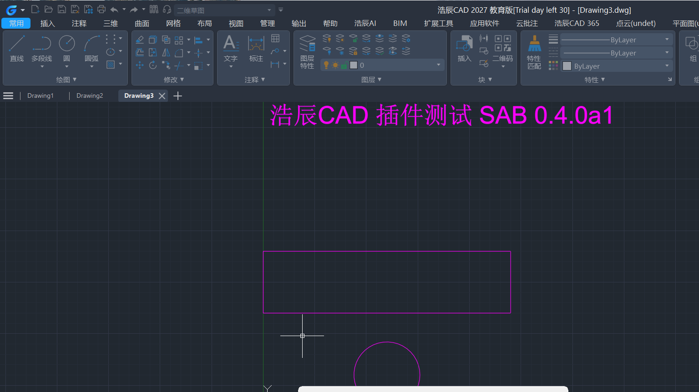

# 工程结构通用智能体插件（ESAB）

[English](README.md) | **简体中文**

[](https://github.com/TopNetizen/esab/actions/workflows/ci.yml)
[](LICENSE)
[](pyproject.toml)
[](https://modelcontextprotocol.io)

**让 AI 在你已装、已授权的工程软件里建模、分析、算题、出报告。**

把 Cursor、WorkBuddy、Claude Desktop，或任何支持 MCP 的智能体，连到本机的工程软件上——
**SAP2000、ETABS、STAAD.Pro、MIDAS GEN NX、Abaqus、Tekla、Rhino、
AutoCAD / 浩辰 / 中望 / BricsCAD、SketchUp、PKPM、PKPM-CAE、SAUSG、PlantS、BIMBase、GBP**，
共 15 款软件、22 套 API 技能。智能体负责驱动，软件负责算，工程判断仍然归你。

ESAB 是一个 [MCP](https://modelcontextprotocol.io)（Model Context Protocol）桥接器。它不建模、不计算、
不绕过任何许可校验——它只是智能体的推理与商业软件的自动化接口之间的**传输与验证层**。

```
MCP 客户端（Cursor / WorkBuddy / Claude Desktop / 任意支持 MCP 的智能体）
    │   MCP：stdio，或带令牌的 Streamable HTTP
    ▼
ESAB  ──  python_executor（常驻会话）· use_skill（API 技能）· adapters（15 个连接入口）
    │   COM　　·　SDK　　·　MCP　　·　REST
    ▼
SAP2000 · ETABS · STAAD.Pro · MIDAS · Abaqus · Tekla · Rhino
AutoCAD / 浩辰 / 中望 / BricsCAD · SketchUp · PKPM · PKPM-CAE · SAUSG · PlantS · BIMBase · GBP
```

## 为什么做这个

每款工程软件都有自动化接口，而且各不相同：这里是 COM 派发，那里是 .NET SDK，有的在随机端口上起一个
本地 MCP 服务，有的要自定义请求头的 REST。智能体没法自己发现这些，而**猜比失败更糟**——一次"看起来
成功"的 `AddBeam()`，足以让工程师彻底不信任 AI 工具。

所以本项目的硬约束是：**桥接器绝不报告它证明不了的连接。**

- 每个连接入口返回 `ConnectResult`，带 `ok`、`live_verified`、判定证据和诊断信息；
- 连接成功必须有一次与目标程序的真实往返：读回 COM 的 `app.Version`、MCP `initialize` + `list_tools`
  双程握手、带响应 id 校验的 TCP 健康探测；
- 目标没开时给出具体诊断（`REGDB_E_CLASSNOTREG`、`ConnectionRefusedError: 10061`、"没有运行中的
  `pkpmmcp` 进程"），不返回空工具表，更不编造能力；
- 工具 schema 原样来自上游，软件没开就不存在对应的工具。

这不是风格偏好。0.4.0 审计中查出并修掉了三条独立的假成功路径，详见
[docs/cad-integration-report.md](docs/cad-integration-report.md)。

## 支持的软件

15 款，覆盖结构分析、有限元、详图、绘图、工厂与 BIM：

| 软件 | 类别 | 接口 | 入口 |
|---|---|---|---|
| SAP2000 | 结构分析 | COM（`SAP2000v1.Helper`） | `connect_sap2000` |
| ETABS | 结构分析 | COM（`ETABSv1.Helper`） | `connect_etabs` |
| STAAD.Pro | 结构分析 | `openstaadpy` | `connect_staad` |
| MIDAS GEN NX | 结构分析 | REST + `MAPI-Key` | `connect_midas` |
| Abaqus | 有限元 | 官方 Python 模块（TCP） | `connect_abaqus` |
| Tekla Structures | 详图 / BIM | .NET（`pythonnet`） | `connect_tekla` |
| Rhino | 建模 | COM，附着优先 | `connect_rhino` |
| AutoCAD / 浩辰 / 中望 / BricsCAD | 绘图 | COM，运行时解析实际产品 | `connect_cad` |
| SketchUp | 建模 | Ruby 桥（TCP） | `connect_sketchup` |
| PKPM（主线 / STS / JCCAD） | 国产结构 | 本机 MCP 服务 | `connect_structural_pm` |
| PKPM-CAE | 有限元 | 本机 MCP 服务 | `connect_structural_cae` |
| SAUSG | 非线性分析 | 本机 MCP 服务 | `connect_sausg` |
| PlantS | 工厂结构 | 本机 MCP 服务 | `connect_plants` |
| BIMBase | 参数化 BIM | 本机 MCP 服务 | `connect_bimbase` |
| GBP | 绿色低碳 | 本机 MCP 服务 | `connect_gbp` |

`connect_cad` 会在运行时解析真实的 CAD 产品：先试 `AutoCAD.Application`，通用 ProgID 不存在时依次
重定向到 `GstarCAD.Application` / `GCAD.Application` / `ZWCAD.Application` / `BricsCAD.Application`。
浩辰这类产品根本没有注册 `AutoCAD.Application`，写死 ProgID 会在软件明明正常运行的机器上报
`REGDB_E_CLASSNOTREG`。

## 安装

```bash
pip install esab
```

Windows 适配器需要额外依赖：

```bash
pip install "esab[win32]"          # comtypes、pywin32、pyautocad —— COM 类产品
pip install "esab[win32,tekla]"    # 追加 pythonnet，支持 Tekla
```

需要 Python 3.11+。桥接器本身跨平台，COM 类适配器天然只能在 Windows 上跑。

## 快速上手

ESAB 有两种运行模式。

### 一、桥接模式：聚合上游 MCP 服务

适用于自带 MCP 服务的软件（PKPM、CAE、SAUSG、PlantS、BIMBase、GBP），或用来做传输自检。

```bash
esab stdio --config bridge.json
```

```jsonc
// bridge.json
{
  "servers": [
    {
      "id": "pkpmmcp",
      "enabled": true,
      "transport": "streamable_http",
      "url": "http://127.0.0.1:PORT/mcp",   // 端口由诊断脚本给出，不要猜
      "notes": "PKPM 主线模块"
    }
  ]
}
```

在客户端里注册（可直接抄 `examples/cursor.mcp.json`、`examples/claude_desktop.mcp.json`）：

```json
{
  "mcpServers": {
    "esab": {
      "command": "esab",
      "args": ["stdio", "--config", "/path/to/bridge.json"]
    }
  }
}
```

### 二、运行时模式：技能 + 常驻 Python 会话

适用于 COM / SDK 类产品。智能体拿到一个长期存活的 Python 进程，`connect_to_server`、`connect_cad`、
`function_search`、`use_skill` 已注入，可以连一次、反复探查真实对象模型，不用每次调用都重连。

```bash
esab agent --skills-root ./skills
```

该模式暴露的工具：

| 工具 | 用途 |
|---|---|
| `python_executor` | 在会话常驻的 Python 进程里执行代码，变量跨调用有效 |
| `use_skill` | 原样读取某产品的 `SKILL.md`，或运行技能目录里的脚本 |
| `cancel_execution` | 结束该会话的 Python 进程；**不会**取消已提交给目标软件的计算 |
| `list_software_adapters` | 15 个连接入口及其证据、实机验证状态 |

### HTTP 模式

Streamable HTTP 可用，但默认只监听回环地址，远程绑定必须同时带显式开关和令牌：

```bash
export ESAB_TOKEN=$(openssl rand -hex 32)
esab http --host 127.0.0.1 --port 47331 --token "$ESAB_TOKEN"
# 远程绑定还需：--allow-remote
```

## 技能

每个支持的产品都带一套技能：`SKILL.md` + 参考资料 + 辅助脚本，纯 Markdown 和 Python，无加密。
技能把"有 API"变成"智能体知道这个 API"：对象模型、可跑示例、以及你一定会撞上的错误码。

大产品还带可检索的 API 索引（`data/skills/*/references/*.db`），由厂商 API 文档构建：Tekla、Abaqus
（2024 / 2025 / 2026）、MIDAS、SAP2000、ETABS、Rhino、SketchUp。这才让智能体去查
`SAPModel.FrameObj.AddByCoord` 及其重载，而不是瞎猜签名。这些索引约占 95 MB，选择入库而不是按需
下载，换来"克隆下来就能用"。

随包技能（22 套）：SAP2000、ETABS、STAAD.Pro、MIDAS、Abaqus、Tekla、Rhino、SketchUp、AutoCAD、
PKPM、PKPM-CAE、SAUSG（SSG）、PlantS、BIMBase、GBP，以及写报告用的 Word、Excel、PPT、PDF 四套。

## 验证，而不是感觉

仓库自带审计工具，可以在你自己的机器上复跑：

```bash
python tools/adapter_audit.py        # 逐个真机调用 15 个连接入口，每个 45 秒超时
python tools/false_positive_probe.py # 四组刻意骗过桥接器的证伪实验
```

`tools/adapter_audit.json` 是参照机上的原始记录：14 个入口正确返回 `ok=False` 并给出具体原因，
1 个（CAD）是真实连接。

[docs/cad-integration-report.md](docs/cad-integration-report.md) 是完整报告：浩辰CAD 2027 的端到端
实机联调（画线、圆、多段线、文字、标注，回读几何，复用 COM 会话）、CAD 连接必须同时成立的 6 个前置
条件、以及沿途查出并修掉的 8 个缺陷——其中三条是假成功：

- `connect_cad()` 返回 `ok=True`，因为 pyautocad 惰性构造，压根没碰 COM；
- `connect_official()` 把返回的错误**字符串**当成成功；
- PlantS 包装层只看进程名就报 `connected: True`，没有任何 MCP 握手。



## 已知限制

- **许可与登录由你负责。** ESAB 附着到已运行、已授权的会话，不自动化激活，不绕过许可校验。
- **YJK（盈建科）、3D3S 尚未覆盖。** 没有对应适配器，也没有技能——问智能体 YJK 的事，得到的是诊断，
  不是编造。要支持 YJK，得先写一个能**证明**活会话的连接入口，缺的是厂商的自动化接口。
- **SAP2000 / ETABS、STAAD、MIDAS 的判据未在参照机上验证。** 审计时这些软件未安装，其连接判据标注为
  "需现场复核"，报告 9.4 节给了复核步骤。这三者返回的 `live_verified` 应视为未证实。
- **部分适配器仅限 Windows。** COM 与 .NET 路径在 macOS / Linux 上不存在，那边只有 MCP / REST 适配器
  和桥接器本体。
- **不做规范符合性判断。** 计算结果与规范符合性仍需有资质的工程师核对。
- **`PKPM-Link/SKILL.md` 引用了 `pkpm_calc.py` 中不存在的 `RunPKPMAnalyse`**，已知未修，执行到该行会
  `ImportError`。

## 开发

```bash
git clone https://github.com/TopNetizen/esab && cd esab
python -m venv .venv && . .venv/bin/activate
pip install -e ".[test]"
pytest tests -q          # 23 passed
```

目录：

```
src/esab/            桥接器、运行时、适配器、技能加载
src/esab_shim/       pyautocad 兼容层与 software_link_kit 包装
src/esab/data/       技能与 API 索引（作为包数据分发）
tests/               单元与端到端测试
tools/               适配器审计与假成功证伪实验
docs/                联调与审计报告
scripts/             Windows 安装 / 验收 PowerShell 脚本
```

提 PR 前请读 [CONTRIBUTING.md](CONTRIBUTING.md)。新增一个产品 = 新增一个**能证明连接**的适配器；靠
"没抛异常"就返回 `ok=True` 的探针，是本项目唯一不会合并的东西。

## 许可证

MIT，见 [LICENSE](LICENSE)。

ESAB 是独立项目，与上表所列任何厂商无关，也未获其背书。产品名称是其各自所有者的商标，此处仅用于描述
互操作性。
