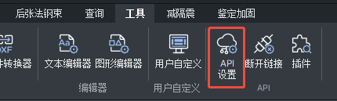

# 连接与诊断

## 连接流程

先调用 `connect_midas()`，按三种情况处理：

1. **MIDAS 已运行且能连接：** 直接使用，不要求用户额外操作。
2. **连接失败，存在 MIDAS 进程：** 请用户在软件中手动打开或新建一个工程，然后连接 API，再重试。
3. **连接失败，不存在 MIDAS 进程：** 请用户提供工程文件完整路径，或自行打开一个工程。拿到路径后才启动 MIDAS 并打开该工程：

```python
from esab_shim.software_link_kit.midas import connect_midas
midas = connect_midas(project_path=r"D:\Projects\框架模型.mgbx")
```

**没有工程路径就不启动程序，即使 `auto_start=True` 也一样。** 路径须为本机已存在的 `.mgbx` / `.mgb` 文件绝对路径。已有进程时不自动切换工程，请用户手动打开；随后不带 `project_path` 重连。新工程由用户在界面中创建。

## API 设置

工程打开后，进入 **工具 → API → API Settings（API 设置）**，点击 Connect（连接），确认 Connected。首次缺少配置或密钥失效时，请用户提供同页配套的 **Base URL** 和 **MAPI-Key**，传给 `connect_midas(base_url=..., mapi_key=...)`。已有有效配置则直接重连，不重复索要密钥。



握手成功后默认保存到当前用户 `%LOCALAPPDATA%\esab\connections\midas.json`，密钥使用 Windows DPAPI 加密；`remember=False` 可不保存。不要在日志、报告、截图或可复用脚本中保存真实密钥。

## 实例选择

有多个实例或安装时，`detect_midas()` 只读列出候选，不返回密钥。让用户选择后，传 `pid=` 连接已有进程，或在提供工程路径时传 `exe_path=` 指定安装。不猜测目标，不关闭其他实例。

连接会核对本机端口归属，并通过产品版本和单位接口握手。`midas.info` 中产品年份与内部构建号分开记录，不要用构建号推断年份。`CONNECTION` 注册表项可能不存在，不要硬编码地址、端口或安装路径；IPv6 环回监听不能擅自替换为 `127.0.0.1`，本机请求不经过环境代理。

显式远程 Base URL 不自动切换区域地址；未指定本机目标时不猜测本机 PID。远程工程由用户打开，`project_path` 只用于本机文件。

## 常见诊断

| code | 含义与处理 |
|---|---|
| `ambiguous_instance` / `ambiguous_installation` | 有多个候选，展示候选 PID/路径让用户选择 |
| `not_installed` / `invalid_executable` | 提供准确的 GenNX.exe 路径 |
| `not_running` | 请用户提供工程文件完整路径，或自行打开工程；不空启动程序 |
| `invalid_project_path` | 启动工程须为本机已存在的 `.mgbx` / `.mgb` 文件绝对路径；新工程先在界面中创建 |
| `startup_project_not_applicable` | `project_path` 只用于新启动进程；已有实例先保存并打开目标工程，再去掉该参数重连 |
| `configuration_required` / `missing_key` / `api_not_ready` | 先打开或新建工程，再在 工具 → API → API 设置 中连接；首次缺配置或密钥失效时提供配套 Base URL 与 MAPI-Key |
| `endpoint_owner_unverified` | 先确认已打开工程并连接 API；本机地址须属于目标 PID 且监听端口可核实，不绕过归属检查 |
| `handshake_failed` | 有进程则请用户手动打开工程并连接 API；无进程则索要工程路径或请用户自行打开。具体原因见 attempts |
| `wrong_product` | 目标不是 GEN NX；传统 Gen 与 CIVIL 不在此运行时范围内 |
| `authentication_failed` | 核对配套密钥和地址，确认 API 已连接；客户端会尝试刷新一次可确定归属的配置 |
| `authentication_refreshed` | 新密钥握手成功；原请求没有自动重发，先检查是否需要继续 |
| `session_changed` | PID 已退出或被复用，重新连接并检查模型 |
| `timeout` | 操作结果未知，检查当前状态及 GEN NX 的保存、路径错误等弹窗；不能立即重发 NEW/OPEN/写入/分析 |
| `legacy_save_format` / `invalid_save_format` | 默认保存为 `.mgbx`；兼容导出 `.mgb` 必须明确选择，可能需要人工处理数据损失提示 |
| `save_directory_missing` / `invalid_save_path` | 指定 GEN NX 主机上的绝对路径，并先建立保存目录 |
| `api_error` | 查看状态和服务端 error，核对接口/参数/版本，不直接重连或反复写入 |
| `endpoint_not_found` | HTTP 404；核对路径、方法、对象 ID 和版本。用 `search` 或 `endpoints DB --recursive` 查文档目录 |

密钥更换时重新调用 `connect_midas` 并提供新配置即可。`clear_saved_connection()` 只清除 esab_shim 保存的配置，不更改 MIDAS 设置。
